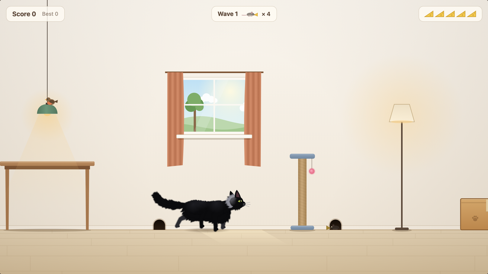

# Catwalk

A fluffy black cat, a room full of furniture, and mice running off with the
cheese. Boop them on the nose and they'll drop it. Nobody gets hurt.

**Play it:** https://peterbriers.be/catwalk/



## Controls

| Key | Action |
| --- | --- |
| ← → | Run |
| Space | Jump: tap for a little hop, hold to jump high |
| ↓ | Sneak on the floor, hop down from furniture |
| P / Esc | Pause |
| M | Sound on or off |
| F | Full screen |

Boops from the air score double, quick boops build a streak, and the mice
can't see you up on the furniture. Grasshoppers, flies and a little bird are
worth bonus points. From wave 6 a dog gallops through: jump over it.

On a phone or tablet the game plays sideways: held upright it asks to be
turned. Buttons appear on the screen: left and right to run, up to jump (tap
for a hop, hold to jump high), down to sneak, plus pause, sound and full
screen. Tap the screen to start or play again; the first game goes full
screen where the browser allows it (Android, iPad; Safari on iPhone has so
far only allowed full screen for videos, so there use *Add to Home Screen*).

## Install it as an app

The game works as an installable web app that also starts offline:

- **Chrome or Edge on a computer:** the install icon at the right of the
  address bar.
- **Android:** the browser menu, then *Add to Home screen* or *Install app*.
- **iPhone or iPad:** Safari's Share button, then *Add to Home Screen*.

High scores are kept in the browser, per device.

## Working on it

There is no build step. Serve the folder and open it:

```bash
python3 scripts/serve.py
```

That serves http://127.0.0.1:4173/ without caching, so edits show on reload.
The service worker stays off on localhost for the same reason.

```bash
npm test
```

runs the unit tests (Node's built-in test runner, no install needed).
`scripts/playwright-cat-check.mjs` drives the cat in a real browser; it needs
`npm install` for Playwright.

- `index.html` holds the game loop, the cat's rig and all drawing.
- `src/` holds the parts that are tested on their own: physics helpers, gait
  and spine maths, wave rules, the dog's gallop, high scores and the sound
  effects.
- `vendor/matter.min.js` is matter-js 0.20.0 (MIT, see
  `vendor/matter-js-LICENSE`), used for collisions.
- `plan.md` has the design notes: how the cat moves and why.

Every push to `main` runs the tests and publishes the site to GitHub Pages
(`.github/workflows/pages.yml`).
